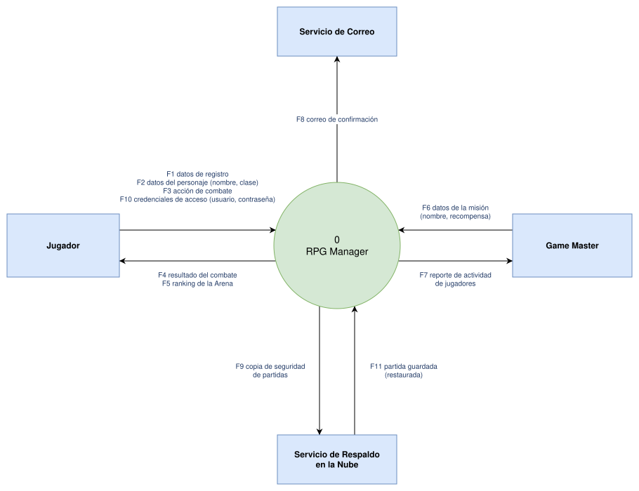
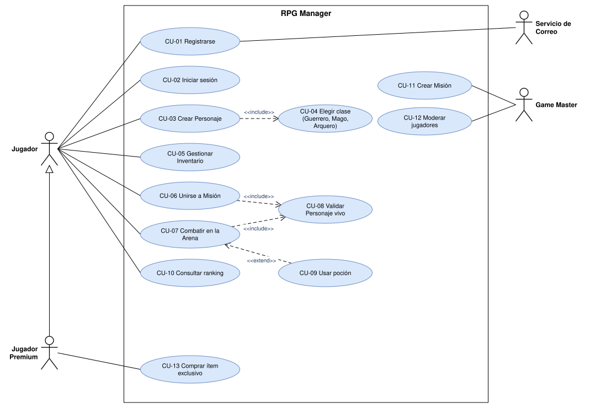
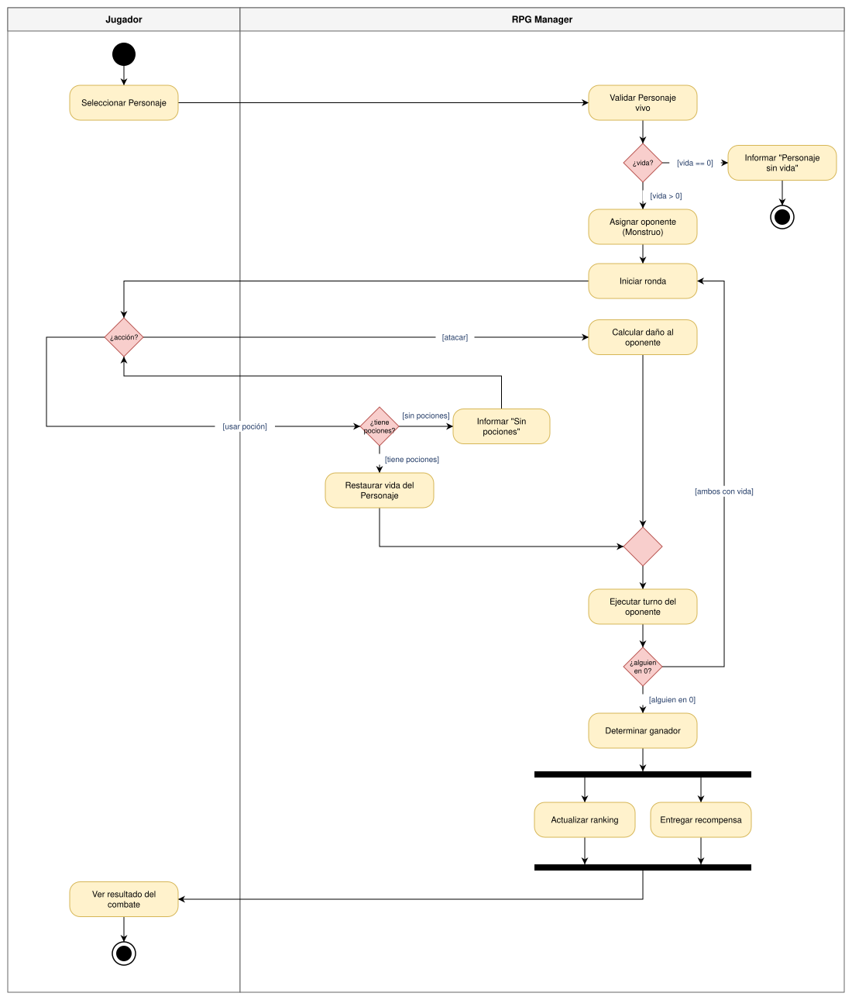
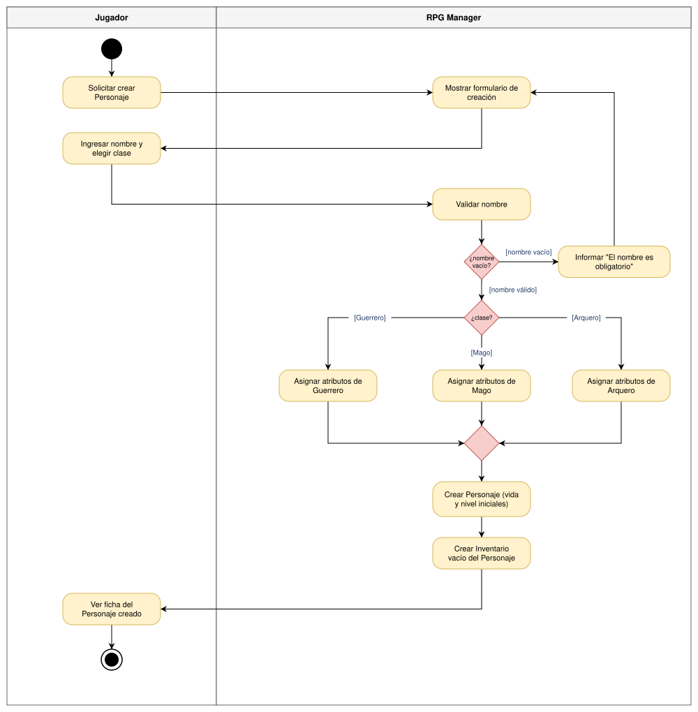

# Taller práctico · Diagramas con draw.io · RPG Manager

**Estudiante:** Cristian Castro Tapiero · **Grupo:** 5 · **Fecha:** 30/10/2026

Archivos editables (`.drawio`) y exportados (`.svg`, con copia del diagrama incluida para reabrirlos en draw.io).

---

## Bloque 1 · Diagrama de contexto (nivel 0)

### Ejercicio 1A · Flujos que faltaban

| # | Origen | Flujo de datos | Destino |
|---|---|---|---|
| F10 | Jugador | credenciales de acceso (usuario, contraseña) | RPG Manager |
| F11 | Servicio de Respaldo en la Nube | partida guardada (restaurada) | RPG Manager |

### Bug a corregir

1. **Error 1:** "Base de datos de Personajes" no es una entidad externa: es un almacén de datos interno del sistema. En el nivel 0 no se dibujan almacenes (aparecen desde el DFD de nivel 1).
2. **Error 2:** El flujo "Crear Personaje" está nombrado con una acción (verbo). Un flujo se nombra con el dato que viaja: "datos del personaje (nombre, clase)". "Crear Personaje" es un caso de uso.
3. **Error 3:** Hay una flecha directa Jugador → Game Master. Dos entidades externas no se conectan entre sí en un diagrama de contexto: todo flujo debe entrar o salir del proceso 0. Si se comunican fuera del sistema, no es asunto del diagrama; si lo hacen a través del sistema, el mensaje pasa por el RPG Manager.

---

## Bloque 2 · Diagrama de casos de uso

### Ejercicio 2A · Generalización de actores

- **¿Hacia dónde apunta el triángulo vacío y por qué?** Hacia **Jugador**, el actor general. La generalización va del caso especial (Jugador Premium) al general, y se lee "el Jugador Premium *es un* Jugador".
- **¿Por qué el Jugador Premium NO necesita líneas a CU-01 … CU-10?** Porque los hereda: al ser un tipo de Jugador, puede hacer todo lo que hace el Jugador. Solo se dibuja la asociación a lo que es exclusivo de él (CU-13 Comprar ítem exclusivo).

### Bug a corregir

1. **Error 1:** "Inventario" es un sustantivo, no un objetivo del actor. Un caso de uso se nombra verbo + sustantivo: "Gestionar Inventario".
2. **Error 2:** El Game Master está dentro del límite del sistema. Los actores son externos al sistema y van fuera del rectángulo.
3. **Error 3:** La flecha «include» está invertida. Debe salir del caso base hacia el incluido: CU-03 Crear Personaje → CU-04 Elegir clase.
4. **Error 4:** No se asocian actores entre sí. Las asociaciones solo unen actores con casos de uso (entre actores solo cabe una generalización, si uno es un tipo del otro).

---

## Bloque 3 · Diagramas de actividades

### CU-07 Combatir en la Arena (incluye el Ejercicio 3A)

### Ejercicio 3A · ¿Y si se acaban las pociones?

- **¿En qué carril va la decisión?** En **RPG Manager**: es el sistema el que consulta el Inventario del Personaje y sabe si quedan pociones.
- **Guarda 1:** `[tiene pociones]` → **Restaurar vida del Personaje** (y luego sigue a la unión y al turno del oponente).
- **Guarda 2:** `[sin pociones]` → **Informar "Sin pociones"**, y el flujo vuelve a la decisión **¿acción?** para que el Jugador elija de nuevo (por ejemplo, atacar).

### Ejercicio 3B · CU-03 Crear Personaje (página 2 del archivo)

- **¿Qué caso de uso del Bloque 2 aparece "escondido" dentro de este flujo?** **CU-04 Elegir clase**: la decisión `[Guerrero] / [Mago] / [Arquero]` es justamente el caso incluido («include») en CU-03.

### Bug a corregir

1. **Error 1:** El rombo "¿Tiene flechas?" tiene una sola salida `[sí]`. Toda decisión necesita guardas que cubran todos los casos: falta la salida `[no]` y a dónde lleva.
2. **Error 2:** El fork abre dos caminos paralelos que terminan cada uno en su nodo final, sin join. Los caminos de un fork deben sincronizarse en un join antes de continuar (y terminar en un solo final); además, el primer nodo final de actividad que se alcance terminaría todo el flujo, cortando el otro camino.
3. **Error 3:** "Calcular daño al oponente" está en el carril del Jugador. Quien calcula el daño es el sistema, así que va en el carril **RPG Manager**; el Jugador solo decide la acción.

---

## Bloque 4 · Entrega

Mensaje del commit: `[semana-N] diagramas contexto, casos de uso y actividades`

**URL de mi commit:** https://github.com/cristianct77/Taller_diagramas/commit/15ff068

---

## Reflexión final

1. **¿Por qué el contexto no muestra la base de datos?** Porque el diagrama de contexto trata el sistema como una caja negra: solo muestra con quién intercambia datos y qué datos cruzan su frontera. La base de datos es parte interna del sistema (no es externa ni la controla otro), así que aparece recién en los DFD de nivel 1 como almacén de datos.
2. **Diferencia entre "datos del personaje" y "Crear Personaje".** "Datos del personaje" es un flujo de datos: lo que viaja (nombre, clase). "Crear Personaje" es un caso de uso: el objetivo que el Jugador logra con el sistema. Uno es un sustantivo (dato), el otro un verbo + sustantivo (funcionalidad).
3. **Ejemplos propios.**
   - «include»: *Gestionar Inventario* «include» *Validar espacio disponible en el Inventario* (siempre se verifica antes de agregar un ítem).
   - «extend»: *Unirse a Misión* «extend» desde *Invitar aliado a la Misión* (solo ocurre si el Jugador decide ir acompañado).
4. **¿Qué aporta el diagrama de actividades?** El orden de los pasos, las decisiones con sus condiciones (guardas), los ciclos (rondas de combate), lo que ocurre en paralelo (fork/join) y quién hace cada paso (carriles). El de casos de uso solo dice *qué* puede hacer cada actor, no *cómo* ni en qué secuencia.
5. **¿En qué clase vive "Calcular daño al oponente"?** En la clase que gestiona el combate, **ArenaDeCombate** (por ejemplo `calcularDanio(atacante, defensor)`), porque necesita datos de ambos participantes (ataque del Personaje, defensa del Monstruo) y es una regla del combate. Una alternativa válida es un método `atacar(objetivo)` en **Personaje**, delegando en su clase (Guerrero, Mago, Arquero) cómo se calcula el daño por polimorfismo.
6. **¿PlantUML o draw.io?** PlantUML para documentación técnica que vive junto al código y cambia seguido (los cambios se leen línea a línea en Git y se revisan en pull requests). draw.io cuando importa el diseño visual: presentaciones, explicaciones a clientes o al equipo, y diagramas con mucho detalle o con distribución específica.

---

## Autoevaluación

| Tema | No entendí | Más o menos | ¡Lo tengo! |
|---|:---:|:---:|:---:|
| Manejo básico de draw.io | ☐ | ☐ | **X** |
| Diagrama de contexto y flujos de datos | ☐ | ☐ | **X** |
| Actores y casos de uso | ☐ | ☐ | **X** |
| «include», «extend» y generalización | ☐ | ☐ | **X** |
| Decisiones, guardas y carriles | ☐ | ☐ | **X** |
| Fork / Join | ☐ | ☐ | **X** |
| Exportar y versionar en GitHub | ☐ | ☐ | **X** |
